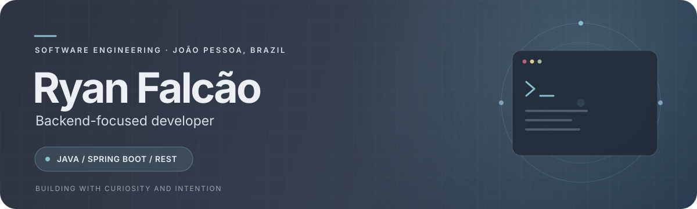
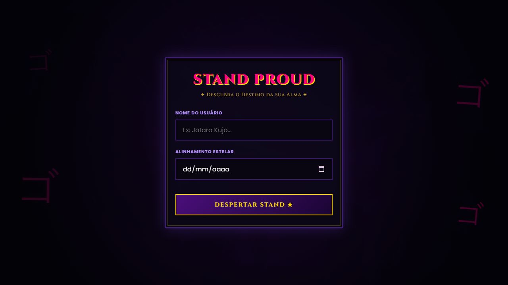
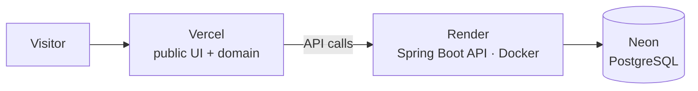
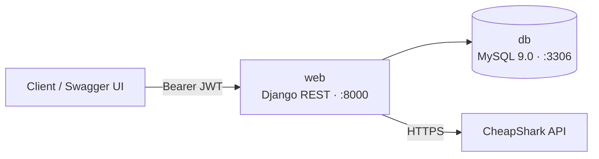

<div align="center">



<a href="https://github.com/Ryan-Falcao">
  
</a>

<br />

[](https://ryan-falcao-portfolio.vercel.app)
[](https://www.linkedin.com/in/ryan-falcao)
[](https://github.com/Ryan-Falcao)


-81A1C1?style=flat-square)


</div>

---

## `~/whoami`

```yaml
name:        Ryan Falcão
role:        Backend & Full Stack Developer
education:   B.Sc. Software Engineering @ UNIPÊ (exp. 2029)
location:    João Pessoa, Brazil  # UTC−3
languages:   [Portuguese (native), English (<your level, e.g. B2 / C1>)]
core_stack:  [Java 21, Spring Boot, Spring Data JPA, PostgreSQL, React]
also:        [Python 3.12, Django REST Framework, TypeScript, Docker, C]
focus:       [REST API design, JWT auth, API security, cloud deployment]
looking_for: Junior / Internship · Backend or Full Stack · Remote
```

---

## ⚡ Highlights

<div align="center">

| 🌐 **3** | 🔌 **10** | 🐳 **Docker** | 🔐 **JWT** |
|:---:|:---:|:---:|:---:|
| apps live in production | documented REST endpoints in one API | Compose + MySQL healthcheck + volumes | custom auth class on SimpleJWT |

</div>

---

## 🧰 Tech stack

<table>
  <tr>
    <td width="130"><b>Backend</b></td>
    <td>
      
      
      
      
      
      
    </td>
  </tr>
  <tr>
    <td><b>Frontend</b></td>
    <td>
      
      
      
    </td>
  </tr>
  <tr>
    <td><b>Data</b></td>
    <td>
      
      
    </td>
  </tr>
  <tr>
    <td><b>API & Auth</b></td>
    <td>
      
      
      
    </td>
  </tr>
  <tr>
    <td><b>DevOps & Cloud</b></td>
    <td>
      
      
      
      
      
      
    </td>
  </tr>
</table>

---

## 🚀 Featured projects

<table>
  <tr>
    <td width="33%" valign="top">
      <a href="https://curtalink.vercel.app/"></a>
      <h3>CurtaLink</h3>
      <p><b>Production URL shortener</b></p>
      <ul>
        <li>Click tracking + password-protected admin dashboard</li>
        <li>Per-IP rate limiting and server-side URL validation</li>
        <li>Vercel → Render (Docker) → Neon PostgreSQL</li>
      </ul>
      <p>
        
        
        
      </p>
      <a href="https://curtalink.vercel.app/"><b>▶ Live</b></a> · <a href="https://github.com/Ryan-Falcao/CurtaLink"><b>Code</b></a>
    </td>
    <td width="33%" valign="top">
      <a href="https://polaris-model.vercel.app/"></a>
      <h3>Polaris Model</h3>
      <p><b>AI-assisted ER modeling tool</b></p>
      <ul>
        <li>Entity-relationship design workflow</li>
        <li>AI integrations for data modeling</li>
        <li>Django REST API + React client</li>
      </ul>
      <p>
        
        
        
      </p>
      <a href="https://polaris-model.vercel.app/"><b>▶ Live</b></a>
    </td>
    <td width="33%" valign="top">
      <a href="https://descubra-seu-stand-frontend.vercel.app/"></a>
      <h3>Descubra seu Stand</h3>
      <p><b>Full-stack, decoupled deploys</b></p>
      <ul>
        <li>React UI consuming a Spring Boot REST API</li>
        <li>Controller / Service / Model layering + CORS config</li>
        <li>Backend and frontend deployed separately</li>
      </ul>
      <p>
        
        
        
      </p>
      <a href="https://descubra-seu-stand-frontend.vercel.app/"><b>▶ Live</b></a> · <a href="https://github.com/Ryan-Falcao/descubra-seu-stand-backend"><b>Code</b></a>
    </td>
  </tr>
</table>

### 🎮 Game Library API — Django REST · JWT · Docker · MySQL

> Complete REST API with auth, external API integration and OpenAPI docs. **[→ View repository](https://github.com/Ryan-Falcao/wsBackendFabricaDeSoftware26.2)** · 40+ commits · ⭐ 3

| | |
|---|---|
| **What it does** | Users register, log in, search games and deals through the **CheapShark API**, build a personal library, rate and remove games |
| **Auth** | Password hashing (`make_password` / `check_password`) · JWT access + refresh tokens · custom `UsuarioJWTAuthentication` class |
| **API design** | 10 endpoints, public vs. protected routes, user resolved from the token (no `user_id` sent by the client), consistent error responses (400 / 401 / 404) |
| **Integration** | External API isolated in a dedicated `CheapSharkService`, with failure handling when the provider is down |
| **Docs** | Swagger UI, ReDoc and OpenAPI 3 schema via `drf-spectacular` |
| **Infra** | Docker Compose with `web` (Django) + `db` (MySQL 9.0), healthcheck and a persistent volume |

---

## 🏗️ Architecture & deployment

**CurtaLink — production topology**



**Game Library API — local topology**



---

## 🔐 Security practices (from my own code)

| Practice | Where |
|---|---|
| Server-side URL validation, `http` / `https` only | CurtaLink |
| SQL injection protection through Spring Data JPA | CurtaLink |
| Escaped output to prevent HTML/JS injection from stored URLs | CurtaLink |
| Per-IP rate limiting on link creation | CurtaLink |
| Secrets in environment variables, never in source | CurtaLink · Game Library API |
| SQL logging disabled in production | CurtaLink |
| Hashed passwords + JWT with refresh flow | Game Library API |

---

## ✅ Engineering practices

<!-- ✅ = used in my projects · 🔄 = actively learning -->

| Practice | Status |
|---|:---:|
| RESTful API design and OpenAPI documentation | ✅ |
| Layered architecture (Controller · Service · Repository) | ✅ |
| JWT authentication and protected routes | ✅ |
| Relational modeling (PostgreSQL / MySQL) | ✅ |
| Docker, Docker Compose and cloud deployment | ✅ |
| External API integration with error handling | ✅ |
| Automated tests (JUnit 5, Mockito, pytest) | 🔄 |
| CI/CD with GitHub Actions | 🔄 |
| Spring Security | 🔄 |

---

## 🕹️ Beyond web

| Project | Description | Stack |
|---|---|---|
| [**Ascensão — A Última Torre**](https://github.com/Ryan-Falcao/AscencaoDaTorre) | 2D game with floor progression, elemental enemies and dodge/attack patterns | C · Raylib |
| [**Jogo da Velha**](https://github.com/ndu-xl/jogo-da-velha-pygame) | Tic-tac-toe with a Pygame interface (collaborative) | Python · Pygame |

---

## 📊 GitHub

<div align="center">


</div>

---

## 🎯 Open to

| | |
|---|---|
| 💼 **Roles** | Backend Developer · Full Stack Developer · Internship / Junior |
| 🌍 **Mode** | Remote · International · Hybrid in João Pessoa |
| 🛠️ **Stack** | Java · Spring Boot · PostgreSQL · Docker · React |
| 🕒 **Timezone** | UTC−3 — overlaps with the Americas and Europe |

<div align="center">

<br />

[](https://www.linkedin.com/in/ryan-falcao)
[](https://ryan-falcao-portfolio.vercel.app)

<sub>Clear interfaces · Dependable systems · Continuous learning</sub>

</div>
