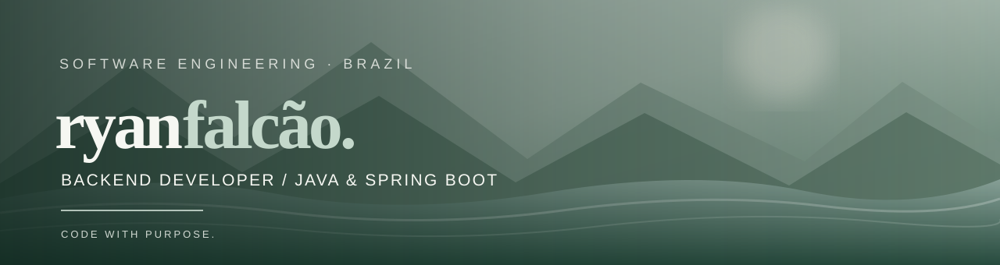
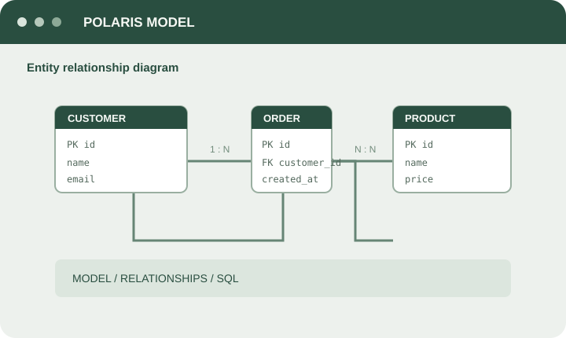
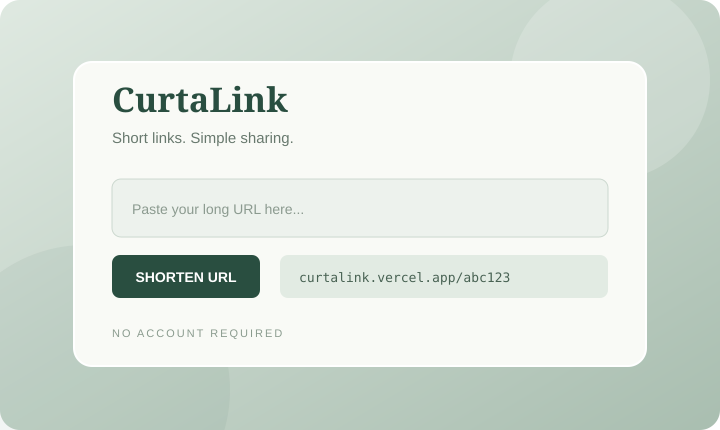

  

  

    <strong>SOFTWARE ENGINEERING STUDENT</strong> &nbsp;·&nbsp;
    <strong>BACKEND DEVELOPER</strong> &nbsp;·&nbsp;
    <strong>JAVA &amp; SPRING BOOT</strong>
  

  

    <a href="https://ryan-falcao.vercel.app/">Portfolio</a>
    &nbsp;·&nbsp;
    <a href="https://www.linkedin.com/in/ryan-falcao/">LinkedIn</a>
    &nbsp;·&nbsp;
    <a href="mailto:ryanmarques2007f@gmail.com">Email</a>
  

  

    
    
    
  

---

## 01 / About me

I'm **Ryan Marques Monteiro Falcão**, a Software Engineering student based in **João Pessoa, Brazil**. My main focus is backend development with **Java, Spring Boot and REST APIs**.

I enjoy connecting the different parts of an application: business logic, data, authentication and user-facing interfaces. I also work with **Python and Django**, relational databases and web technologies.

My projects are where I put these interests into practice. I'm currently looking for an opportunity to contribute to a development team, learn from other engineers and keep growing in backend development, application security and software architecture.

> Behind every good user experience, there is a well-built backend.

## 02 / Technology stack

The areas below reflect the technologies and tools featured in my portfolio.

  
   
  
   
  

<table>
  <tr>
    <td width="50%" valign="top">
      <strong>Backend &amp; APIs</strong> 
      Java · Spring Boot · Python · Django · REST APIs
    </td>
    <td width="50%" valign="top">
      <strong>Security</strong> 
      Spring Security · JWT · OAuth
    </td>
  </tr>
  <tr>
    <td width="50%" valign="top">
      <strong>Data &amp; databases</strong> 
      SQL · PostgreSQL · MySQL · Azure Data Lake
    </td>
    <td width="50%" valign="top">
      <strong>Web interfaces</strong> 
      React · TypeScript · JavaScript
    </td>
  </tr>
  <tr>
    <td width="50%" valign="top">
      <strong>Infrastructure &amp; tools</strong> 
      Docker · Git · GitHub
    </td>
    <td width="50%" valign="top">
      <strong>Programming fundamentals</strong> 
      C · Programming logic
    </td>
  </tr>
</table>

## 03 / Selected projects

<table>
  <tr>
    <td width="42%" valign="top">
      
    </td>
    <td valign="top">
      <h3>Polaris Model</h3>
      
<strong>Database modeling, from idea to structure.</strong>

      
Create entity-relationship diagrams, document business rules and turn database models into SQL. Polaris Model brings the modeling workflow into one online tool.

      
<code>Python</code> <code>Django</code> <code>React</code> <code>TypeScript</code> <code>SQL</code>

      <a href="https://polaris-model.vercel.app/">Explore Polaris Model ↗</a>
    </td>
  </tr>
  <tr>
    <td width="42%" valign="top">
      
    </td>
    <td valign="top">
      <h3>Descubra seu Stand</h3>
      
<strong>An interactive experience powered by a Java backend.</strong>

      
Enter a name and date of birth to receive a personalized card. The project connects a React interface to a Java and Spring Boot backend through a REST API.

      
<code>Java</code> <code>Spring Boot</code> <code>React</code> <code>REST API</code>

      <a href="https://descubra-seu-stand-frontend.vercel.app/">Explore Descubra seu Stand ↗</a>
    </td>
  </tr>
  <tr>
    <td width="42%" valign="top">
      
    </td>
    <td valign="top">
      <h3>CurtaLink</h3>
      
<strong>A simple utility for sharing shorter links.</strong>

      
Turn long URLs into short, shareable links. Paste an address, generate the short link and copy it — no account required.

      
<code>URL Shortener</code> <code>Persistent Links</code> <code>Web Application</code>

      <a href="https://curtalink.vercel.app/">Explore CurtaLink ↗</a>
    </td>
  </tr>
</table>

<a href="https://github.com/Ryan-Falcao?tab=repositories">More on GitHub ↗</a>

Project preview graphics are illustrative. Visit each live project to see its actual interface.

## 04 / Education

**Software Engineering** · UNIPÊ — Centro Universitário de João Pessoa  
*Undergraduate degree in progress · 2026–2029 (expected)*

## 05 / Certifications

| Course | Issuer | Date |
|:--|:--|:--|
| Introduction to Generative AI and Agents | Microsoft | Sep 2026 |
| Introduction to Git | Microsoft | Sep 2026 |
| Introduction to Data Engineering on Azure | Microsoft | Jul 2026 |
| Prompt Engineering and Applications in AI | UNIPÊ | Jun 2026 |
| Introduction to Object-Oriented Programming | Fundação Bradesco | Feb 2026 |

## 06 / Let's connect

I'm interested in meeting developers, exchanging ideas and exploring opportunities to contribute to software teams. I'm open to **internship and junior/entry-level backend opportunities**, including international and remote positions.

  
  
  
    
  Built with curiosity. Improved one project at a time.

