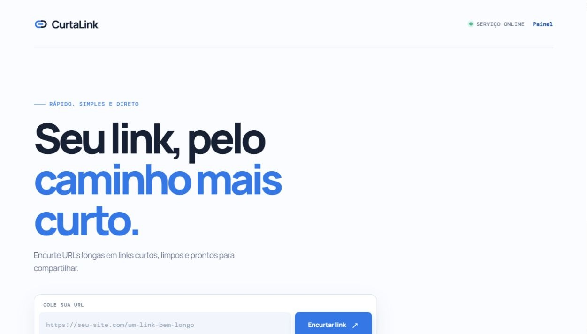
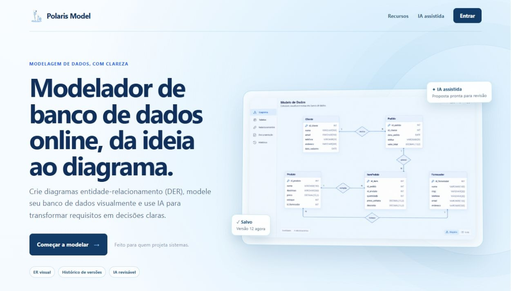

 

  

 

!Open to Work !Location !Remote

About Me

I'm a Software Engineering student and Backend Developer from Brazil, focused on building reliable backend applications, well-structured REST APIs, and practical software solutions.

My primary stack is Java, Spring Boot, and relational databases, with hands-on experience developing and deploying applications using Docker and cloud platforms.

I also have experience with Python, Django REST Framework, React, and TypeScript, which allows me to work across different layers of an application.

I enjoy understanding how systems work behind the scenes, designing clean architectures, implementing secure authentication, and turning ideas into functional products.

Currently pursuing a B.Sc. in Software Engineering at UNIPÊ, with expected graduation in 2029.

yaml
name: Ryan Falcão
role: Backend Developer
location: João Pessoa, Brazil (UTC-3)
education: B.Sc. Software Engineering — UNIPÊ
graduation: 2029

primary_stack:
  - Java 21
  - Spring Boot
  - Spring Data JPA
  - PostgreSQL

additional_technologies:
  - Python
  - Django REST Framework
  - React
  - TypeScript
  - Docker
  - MySQL

areas_of_interest:
  - Backend Engineering
  - REST API Development
  - Software Architecture
  - API Security
  - Cloud Deployment

opportunities:
  - Junior Backend Developer
  - Backend Engineering Internship
  - Junior Full Stack Developer

3	10	Docker	JWT
Deployed applications	REST API endpoints	Containerized environments	Token-based authentication

Backend Development

Frontend Development

Databases

API Development & Security

DevOps & Cloud

Featured Projects
01. CurtaLink

A URL shortener with analytics and administrative features.

A production-deployed application designed to provide URL shortening, click tracking, and secure link management.

Key features

Click tracking and password-protected administration dashboard.
Server-side URL validation.
Per-IP rate limiting for link creation.
Containerized Spring Boot backend.
PostgreSQL persistence.

Architecture: Vercel → Render (Docker) → Neon PostgreSQL

Technologies: Java 21 · Spring Boot · PostgreSQL · Docker

Live Application · Source Code

02. Polaris Model

An AI-assisted entity-relationship modeling tool.

A web application focused on supporting database modeling workflows through an interactive interface and AI integrations.

Key features

Entity-relationship modeling workflow.
AI integrations for data modeling.
Decoupled frontend and backend architecture.
RESTful API integration.

Technologies: Python · Django REST Framework · React

Live Application

03. Descubra seu Stand

A full-stack application with independently deployed services.

A full-stack project demonstrating the integration of a React frontend with a Spring Boot REST API.

Key features

React frontend consuming a REST API.
Layered backend architecture.
Controller, Service, and Model separation.
Cross-Origin Resource Sharing (CORS) configuration.
Independent frontend and backend deployments.

Technologies: Java · Spring Boot · React

Live Application · Backend Source Code

04. Game Library API

A REST API for personal game collections.

A backend project featuring authentication, external API integration, database persistence, and interactive API documentation.

View Repository

Key features

User registration and authentication.
JWT access and refresh token workflow.
Protected endpoints with custom authentication.
Game search and deal integration through the CheapShark API.
Personal game libraries, ratings, and removal.
Consistent HTTP error handling.
OpenAPI 3 documentation.

Technical implementation

Component	Implementation
Backend	Django REST Framework
Authentication	JWT and custom authentication class
Database	MySQL 9.0
External integration	CheapShark API
Documentation	Swagger UI, ReDoc, drf-spectacular
Infrastructure	Docker Compose
Persistence	MySQL persistent volume

The external API integration is isolated in a dedicated CheapSharkService, keeping business logic separated from third-party communication.

Architecture & Deployment
CurtaLink — Production Architecture
mermaid
flowchart LR
    U["Visitor"] --> V["Vercel Frontend"]
    V -->|API Requests| R["Render Spring Boot API · Docker"]
    R --> N[("Neon PostgreSQL")]

Game Library API — Development Architecture
mermaid
flowchart LR
    C["Client / Swagger UI"] -->|"Bearer JWT"| W["Django REST API Port 8000"]
    W --> D[("MySQL 9.0 Port 3306")]
    W -->|HTTPS| X["CheapShark API"]

Security & Engineering Practices

I consider security and maintainability essential parts of backend development.

Practice	Implementation
Server-side URL validation	CurtaLink
HTTP/HTTPS protocol validation	CurtaLink
ORM-based database access	CurtaLink
Output escaping	CurtaLink
Per-IP rate limiting	CurtaLink
Environment-based secrets	CurtaLink · Game Library API
Production SQL logging configuration	CurtaLink
Password hashing	Game Library API
JWT authentication and refresh tokens	Game Library API
Protected API endpoints	Game Library API

Engineering Practices & Continuous Learning
Area	Status
RESTful API design and OpenAPI documentation	Applied
Layered architecture	Applied
JWT authentication and authorization	Applied
Relational database modeling	Applied
Docker and Docker Compose	Applied
Cloud application deployment	Applied
External API integration	Applied
JUnit 5 and Mockito	Learning
Pytest	Learning
GitHub Actions and CI/CD	Learning
Spring Security	Learning

Beyond Web Development

I also enjoy exploring software development through programming fundamentals, game development, and collaborative projects.

Project	Description	Technologies
Ascensão — A Última Torre	2D game featuring floor progression, elemental enemies, and combat mechanics	C · Raylib
Jogo da Velha	Collaborative tic-tac-toe game with a graphical interface	Python · Pygame

Open to Opportunities

I'm currently looking for opportunities to grow as a software engineer and contribute to collaborative development teams.

	
Positions	Junior Backend Developer · Backend Engineering Intern · Junior Full Stack Developer
Work model	Remote · International · Hybrid in João Pessoa, Brazil
Preferred stack	Java · Spring Boot · PostgreSQL · Docker
Location	João Pessoa, Brazil
Time zone	UTC−3

 

 

Building reliable software. Solving real problems. Learning continuously.

